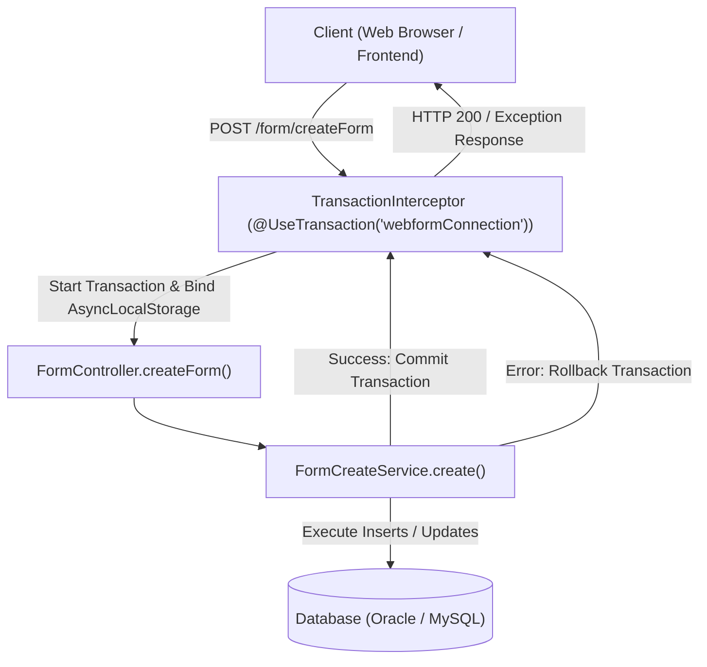
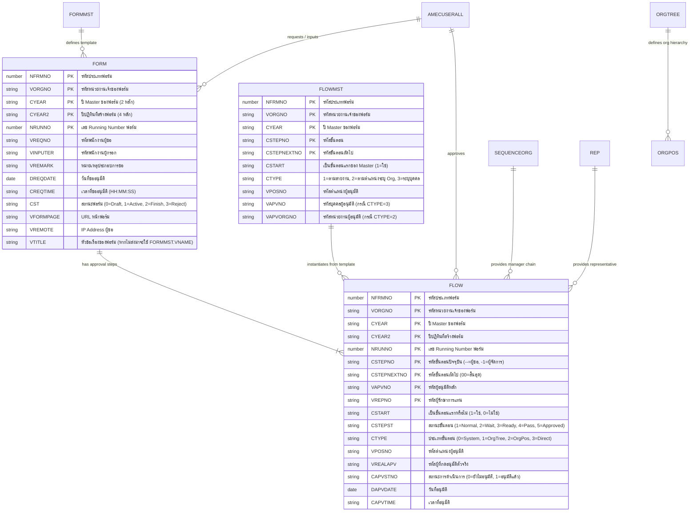
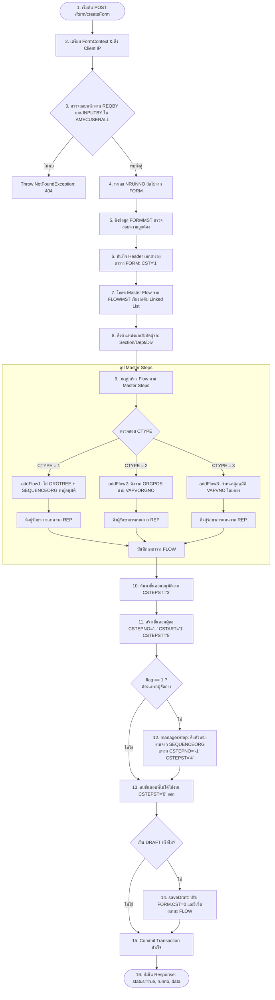
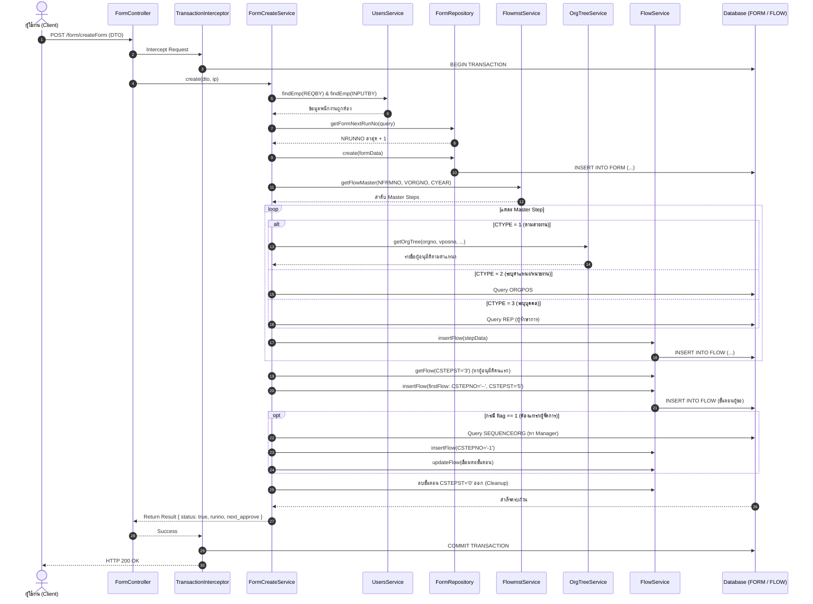

# เอกสารการทำงานระบบ Webflow: Create Form Flow (การสร้างฟอร์มขออนุมัติ)

เอกสารฉบับนี้อธิบายกระบวนการทำงาน สถาปัตยกรรม ฐานข้อมูล และ Logic ทั้งหมดของฟังก์ชัน **Create Form (`webform/createForm`)** ในระบบ Webflow Backend API เพื่อให้ทีมงานสามารถทำความเข้าใจ ดูแลรักษา และพัฒนาต่อยอดในอนาคตได้อย่างถูกต้องและปลอดภัย

---

## 1. ภาพรวมระบบ (Overview & Architecture)

ฟังก์ชัน `createForm` ทำหน้าที่รับคำขอสร้างเอกสารขออนุมัติใหม่จากผู้ใช้งาน ทำการตรวจสอบสิทธิ์ ดึงข้อมูลเส้นทางการอนุมัติ (Workflow Route) ตามประเภทฟอร์ม คำนวณหาผู้อนุมัติตามสายงานหรือตำแหน่ง จากนั้นสร้างบันทึกเอกสาร (`FORM`) พร้อมทั้งสร้างขั้นตอนการอนุมัติ (`FLOW`) ทั้งหมดลงในฐานข้อมูลภายใต้ **Database Transaction เดียวกัน**

### ข้อมูล Endpoint และ Entry Point
- **Method & Route:** `POST /form/createForm`
- **Controller:** [`FormController.createForm`](../../src/webform/form/form.controller.ts#L136-L145)
- **Primary Service:** [`FormCreateService.create`](../../src/webform/form/create-form.service.ts#L67-L181)
- **Database Connection:** `webformConnection` (รองรับทั้ง **Oracle Database** และ **MySQL Database**)

---

## 2. โครงสร้างตารางและ Entity ที่เกี่ยวข้อง (Data Dictionary)

การทำงานของ `createForm` มีการเชื่อมโยงกับ Entity/ตารางในระบบทั้งหมด 9 ตาราง ดังนี้:

| ตาราง (Table) | Entity Class | หน้าที่ในระบบ |
| :--- | :--- | :--- |
| **`FORM`** | [`FORM`](../../src/common/Entities/webform/table/FORM.entity.ts) | ตาราง Header หลักของฟอร์ม เก็บข้อมูลเลขที่ฟอร์ม, ชื่อเรื่อง (`VTITLE`), ผู้ขอ, ผู้อิมพุต, วันที่ขอ, สถานะฟอร์ม (`CST`) |
| **`FLOW`** | [`FLOW`](../../src/common/Entities/webform/table/FLOW.entity.ts) | ตารางเก็บขั้นตอนการอนุมัติจริงของแต่ละฟอร์ม (`NRUNNO`) เก็บสถานะผู้อนุมัติแต่ละลำดับ (`CSTEPST`) |
| **`FORMMST`** | [`FORMMST`](../../src/common/Entities/webform/table/FORMMST.entity.ts) | ตาราง Master ของประเภทฟอร์ม เก็บชื่อเต็มฟอร์ม (`VNAME`), ชื่อย่อฟอร์ม (`VANAME`), URL หน้าฟอร์ม (`VFORMPAGE`), อายุเอกสาร |
| **`FLOWMST`** | [`FLOWMST`](../../src/common/Entities/webform/table/FLOWMST.entity.ts) | ตาราง Master Template เส้นทางการอนุมัติของแต่ละฟอร์มและ Org ที่กำหนดไว้ล่วงหน้า |
| **`ORGTREE`** | [`ORGTREE`](../../src/common/Entities/webform/table/ORGTREE.entity.ts) | โครงสร้างลำดับชั้นองค์กร (Section -> Department -> Division -> Company) สำหรับไต่หา Org แม่ |
| **`ORGPOS`** | [`ORGPOS`](../../src/common/Entities/webform/table/ORGPOS.entity.ts) | แมปปิ้งผู้ถือตำแหน่งในแต่ละ Organization (`VORGNO` + `VPOSNO` -> `VEMPNO`) |
| **`SEQUENCEORG`** | [`SEQUENCEORG`](../../src/common/Entities/webform/table/SEQUENCEORG.entity.ts) | สายการบังคับบัญชาโดยตรง (พนักงาน `EMPNO` -> หัวหน้างาน `HEADNO`) |
| **`REP`** | [`REP`](../../src/common/Entities/webform/table/REP.entity.ts) | การแต่งตั้งผู้รักษาการ/ตัวแทนอนุมัติ (`VEMPNO` -> `VREPNO`) ประจำแต่ละประเภทฟอร์ม |
| **`AMECUSERALL`** | [`User`](../../src/amec/users/entities/user.entity.ts) | ข้อมูลพนักงาน (รหัส, ชื่อ, ตำแหน่ง `SPOSCODE`, แผนก `SSECCODE`, ฝ่าย `SDEPCODE`, กอง `SDIVCODE`) |

### ความสัมพันธ์ระหว่างตาราง (Entity Relationship Diagram)

---

## 3. ตารางรหัสสถานะสำคัญ (Status Reference)

### 3.1 สถานะของฟอร์ม (`FORM.CST`)
- **`'0'` (Draft):** ฟอร์มแบบร่าง ผู้ขอยังไม่ได้ส่งขออนุมัติจริง
- **`'1'` (Active / On-going):** ฟอร์มส่งแล้ว อยู่ระหว่างขั้นตอนการอนุมัติ
- **`'2'` (Finish / Approved):** ฟอร์มผ่านการอนุมัติครบทุกขั้นตอนเสร็จสมบูรณ์
- **`'3'` (Reject):** ฟอร์มถูกปฏิเสธ/ไม่อนุมัติ

### 3.2 สถานะขั้นตอนการอนุมัติ (`FLOW.CSTEPST`)
- **`'0'` (Not Use):** ขั้นตอนที่ไม่ได้ใช้งาน (เช่น หาผู้อนุมัติไม่พบ จะถูกลบออกก่อนเสร็จสิ้น)
- **`'1'` (Normal):** รอขั้นตอนก่อนหน้า ขั้นตอนยังไม่ถึงคิว
- **`'2'` (Wait):** อยู่ในคิวถัดไป รอให้ขั้นตอนปัจจุบันเสร็จ
- **`'3'` (Ready):** **ถึงคิวอนุมัติแล้ว** (ผู้อนุมัติจะเห็นฟอร์มในกล่องงาน `waitforapprove`)
- **`'4'` (Pass):** ขั้นตอนที่ถูกข้าม หรือรอส่งต่อ
- **`'5'` (Approved):** อนุมัติเรียบร้อยแล้ว (ขั้นตอนของผู้ขอจะถูกตั้งเป็น '5' ทันทีเมื่อสร้างเสร็จ)

### 3.3 ประเภทขั้นตอนการอนุมัติ (`FLOWMST.CTYPE`)
- **`'1'` (Organizational Hierarchy):** หาผู้อนุมัติตามสายงานของตัวผู้ขอ โดยไต่ระดับชั้นองค์กรผ่าน `ORGTREE` และหาผู้มีตำแหน่ง `VPOSNO` นั้นใน `ORGPOS` พร้อมตรวจสายบังคับบัญชาใน `SEQUENCEORG`
- **`'2'` (Specific Org & Position):** หาผู้อนุมัติจากตำแหน่ง `VPOSNO` ในหน่วยงานที่ระบุ `VAPVORGNO` เจาะจงจาก `ORGPOS`
- **`'3'` (Direct Person):** ระบุรหัสพนักงานผู้อนุมัติ `VAPVNO` เจาะจงโดยตรง

---

## 4. ขั้นตอนการทำงานโดยละเอียด (Step-by-Step Flow)

---

### คำอธิบายขั้นตอนอย่างละเอียด:

### ขั้นตอนที่ 1: Controller & Transaction Initialization
- Controller เรียกใช้งาน Decorator `@UseTransaction('webformConnection')`
- `TransactionInterceptor` ทำการเปิด Transaction บน `webformConnection` และผูก Transactional `EntityManager` เข้ากับ Context ของ Request นั้น

### ขั้นตอนที่ 2: เตรียม Context และ Validate พนักงาน
- ตรวจสอบ `dto.REQBY` (ผู้ขอ) และ `dto.INPUTBY` (ผู้กรอก)
- หาก `INPUTBY` เป็นค่าว่าง จะใช้ `REQBY` แทน
- เรียก `usersService.findEmp()` ตรวจสอบว่ามีข้อมูลพนักงานจริงในระบบทั้งสองคน หากไม่พบจะโยน `NotFoundException`

### ขั้นตอนที่ 3: คำนวณเลข Running Number (`NRUNNO`)
- เรียก `repo.getFormNextRunNo()` ค้นหาเลขล่าสุดของกลุ่ม `(NFRMNO, VORGNO, CYEAR, CYEAR2)`
- แปลงเป็นตัวเลขด้วย `Number(form[0].NRUNNO) + 1` (เพื่อความปลอดภัยบน MySQL DECIMAL ที่ส่งค่าเป็น String) หากเป็นฟอร์มแรกจะได้เลข `1`

### ขั้นตอนที่ 4: ตรวจสอบ Master Form (`FORMMST`)
- เรียก `formmstService.getFormmst()` เพื่อดึง Template ของฟอร์ม
- ตรวจสอบว่ามีข้อมูล Master หรือไม่ หากไม่มีจะแจ้งเตือน `Form master not found`
- ดึง URL หน้าฟอร์ม (`VFORMPAGE`) และชื่อฟอร์มตั้งต้น (`VNAME`) เพื่อนำไปบันทึก

### ขั้นตอนที่ 5: บันทึกข้อมูล Header เอกสารลงตาราง `FORM`
- สร้าง Object ข้อมูลฟอร์ม:
  - กำหนดวันที่ `DREQDATE` เป็นเวลาเที่ยงคืน (`00:00:00`)
  - กำหนดเวลา `CREQTIME` รูปแบบ `HH:MM:SS`
  - กำหนดสถานะ `CST = '1'` (Active)
  - กำหนด `VREMOTE` เป็น Client IP Address
  - กำหนด `VTITLE`: หาก Frontend ส่งค่า `VTITLE` มา (และไม่ใช่ค่าว่าง) จะใช้ค่านั้น แต่หากไม่ได้ส่งมา ระบบจะนำค่า `VNAME` จาก `FORMMST` มาใส่ให้โดยอัตโนมัติ
- บันทึกลงตาราง `FORM` ผ่าน `repo.create(formData)`

### ขั้นตอนที่ 6: โหลด Master Flow และจัดเรียง Linked List
- เรียก `flowmstService.getFlowMaster(NFRMNO, VORGNO, CYEAR)`
- ระบบจะดึง Master Steps ทั้งหมดขึ้นมาจัดเรียงตามลำดับใน Memory (เริ่มจาก `CSTART = '1'` แล้วตามด้วย `CSTEPNO = prior CSTEPNEXTNO`) ทำให้ได้ลำดับการอนุมัติที่แท้จริง

### ขั้นตอนที่ 7: หาตำแหน่งและหน่วยงานของผู้ขอ
- ตรวจสอบระดับสายงานของผู้ขอ (`context.emppos = user.SPOSCODE`)
- ค้นหา Org สังกัด: ดูจาก Section (`SSECCODE`) หากเป็น `'00'` ให้ถอยไปดู Department (`SDEPCODE`) และ Division (`SDIVCODE`) ตามลำดับ

### ขั้นตอนที่ 8: วนลูปสร้างแต่ละ Step ลงตาราง `FLOW`
- ตัวนับสถานะเริ่มต้นที่ `CSTEPSTDX = 4` โดยลำดับแรกจะได้รับสถานะ `3` (Ready) และลำดับถัดไปจะลดลงเป็น `2` (Wait) และ `1` (Normal)
- ตรวจสอบ `CTYPE`:
  - **`CTYPE = 1`:** เรียก `addFlow1` โดยค้นหาใน `ORGTREE` + `SEQUENCEORG` เพื่อหาผู้ดำรงตำแหน่งตามสายงาน หากไม่พบใน `ORGPOS` จะเซ็ต `flag = 1` เพื่อไปแทรกขั้นตอนผู้จัดการในภายหลัง
  - **`CTYPE = 2`:** เรียก `addFlow2` หาผู้ดำรงตำแหน่งจาก `ORGPOS` ตาม `VAPVORGNO` ที่กำหนดใน Master
  - **`CTYPE = 3`:** กำหนด `VAPVNO` จาก Master โดยตรง
- ในทุก Step จะเรียก `getRepresent` ตรวจสอบตาราง `REP` เสมอว่ามีผู้รักษาการแทนหรือไม่ หากมีจะใส่ในช่อง `VREPNO`

### ขั้นตอนที่ 9: สร้างขั้นตอนแรกของผู้ขอ (`First Flow`)
- ค้นหาว่าขั้นตอนใดได้รับสถานะ `CSTEPST = '3'` (ขั้นตอนที่พร้อมอนุมัติคนแรก)
- สร้าง Record ของผู้ขอลงในตาราง `FLOW`:
  - `CSTEPNO = '--'` (สัญลักษณ์ขั้นตอนผู้ขอ)
  - `CSTEPNEXTNO`: ชี้ไปยัง `CSTEPNO` ของผู้อนุมัติคนแรก
  - `CSTART = '1'` (เป็นขั้นตอนเริ่มต้น)
  - `CSTEPST = '5'` (Approved อนุมัติโดยอัตโนมัติ)
  - `CAPVSTNO = '1'` (ดำเนินการแล้ว)
  - บันทึก `DAPVDATE` และ `CAPVTIME` เป็นวันเวลาปัจจุบัน

### ขั้นตอนที่ 10: แทรกขั้นตอนผู้จัดการ (`managerStep` - กรณี `flag == 1`)
- เกิดขึ้นเมื่อขั้นตอนแรกไม่พบผู้อนุมัติตามตำแหน่งในสายงานปกติ
- ค้นหาหัวหน้างานโดยตรงจากตาราง `SEQUENCEORG`
- หากพบหัวหน้างาน จะสร้างขั้นตอนแทรก:
  - `CSTEPNO = '-1'` (สัญลักษณ์ขั้นตอนผู้จัดการ)
  - `CSTEPST = '4'` (Pass)
  - `VAPVNO`: รหัสหัวหน้างาน (`HEADNO`)
- ปรับปรุงขั้นตอนของผู้ขอ (`CSTEPNO = '--'`) ให้ `CSTEPNEXTNO` ชี้มาที่ `'-1'`
- เรียก `flowService.reAlignFlow` เพื่อลดระดับสถานะของขั้นตอนอื่นที่รออยู่ลง 1 สเต็ป

### ขั้นตอนที่ 11: ลบขั้นตอนที่ไม่ได้ใช้งาน (`CSTEPST = '0'`)
- ค้นหา Record ใน `FLOW` ที่มีสถานะ `'0'`
- เรียก `deleteFlowStepService.deleteFlowStep()` เพื่อทำการเชื่อมโยง Step ก่อนหน้าและถัดไปเข้าด้วยกัน (Re-link pointer) แล้วลบ Record นั้นออกจากตาราง `FLOW`

### ขั้นตอนที่ 12: บันทึกแบบร่าง (`saveDraft` - ถ้ามี)
- หากส่ง `dto.DRAFT` มา ระบบจะปรับ `FORM.CST` เป็นค่าร่าง (`'0'`)
- รีเซ็ตค่าการอนุมัติใน `FLOW` ทุก Step เพื่อให้กลายเป็นสถานะรอส่ง

### ขั้นตอนที่ 13: ส่งผลลัพธ์กลับ
- หากกระบวนการทั้งหมดสำเร็จ TransactionInterceptor จะทำการ Commit ลงฐานข้อมูล
- ส่ง Response แจ้ง `runno`, `empno`, `formtype`, `next_approve` (รหัสผู้อนุมัติคนแรกที่จะได้รับงาน)

---

## 5. Sequence Diagram แสดงการโต้ตอบของระบบ

---

## 6. ข้อควรระวังและแนวทางการแก้ไขในอนาคต (Maintenance Guide)

### 1. ความเป็น Database-Agnostic (Oracle & MySQL Compatibility)
- **หลีกเลี่ยงการเขียน Raw SQL:** ให้ใช้ TypeORM Repository API (`find`, `findOne`, `save`, `update`, `delete`) เสมอ
- **ระวังฟังก์ชัน String Concatenation & Date:** ห้ามใช้ `||` หรือ `TO_DATE` ใน SQL เพราะ MySQL ไม่รองรับ ให้ดึงค่าดิบแล้วแปลงใน TypeScript
- **การจัดการ Running Number:** ใน MySQL ชนิดข้อมูล `DECIMAL` จะถูกอ่านเป็น `string` ต้องครอบด้วย `Number(...) + 1` เสมอ เพื่อป้องกันข้อผิดพลาด `"1" + 1 = "11"`

### 2. การเพิ่มเงื่อนไขผู้อนุมัติใหม่ (`CTYPE`)
- หากต้องการเพิ่มเงื่อนไขการอนุมัติแบบใหม่ ให้ไปเพิ่ม `case` ในฟังก์ชัน `create()` ของ [`FormCreateService`](../../src/webform/form/create-form.service.ts)
- ผู้อนุมัติที่ได้มาต้องนำไปผ่านฟังก์ชัน `getRepresent(empno, context)` เสมอ เพื่อให้ระบบผู้รักษาการแทน (`REP`) ยังคงทำงานได้ถูกต้อง

### 3. การจัดการ Transaction
- Endpoint นี้ผูกกับ `@UseTransaction('webformConnection')`
- ทุก Repository ที่เรียกใช้งานต้อง extend มาจาก [`BaseRepository`](../../src/common/repositories/base-repository.ts) เพื่อให้เรียกใช้ `this.manager` ซึ่งเป็น Transactional Runner เดียวกัน หากเรียกผ่าน DataSource อิสระ คำสั่งจะไม่ถูก Rollback เมื่อเกิดข้อผิดพลาด
